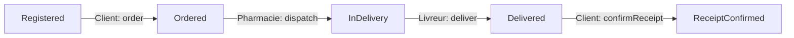
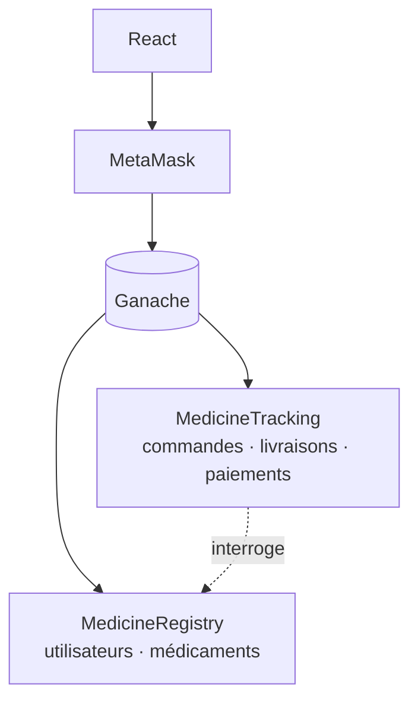

<div align="center">

# 💊 PharmaTrace

**Suivez chaque médicament, de la pharmacie jusqu'au client — sur la blockchain.**


</div>

---

## ✨ En bref

PharmaTrace est une DApp qui enregistre les médicaments, gère les commandes, suit les livraisons et répartit automatiquement les paiements grâce à deux smart contracts.

- 🔎 **Transparence** : chaque étape est horodatée et publique
- 🔐 **Paiement sécurisé** : l'argent reste bloqué jusqu'à la confirmation de réception
- ⚖️ **Répartition automatique** : 80 % pharmacie · 20 % livreur
- 🚨 **Signalements** : le client peut déclarer un problème

---

## 👥 Rôles

| Rôle | Actions |
|---|---|
| 🏥 **Pharmacie** | Enregistre les médicaments, désigne un livreur |
| 🚚 **Livreur** | Marque la commande comme livrée |
| 🧑 **Client** | Commande, confirme la réception, signale un problème |

---

## 🔄 Cycle d'une commande



Après confirmation, les gains sont crédités et retirables via `withdraw()`.

---

## 🏗️ Architecture



| Contrat | Rôle |
|---|---|
| `MedicineRegistry` | Inscription des utilisateurs, fiches médicaments (nom, lot, expiration, prix) |
| `MedicineTracking` | Commandes, livraisons, historique, signalements, retraits |

---

## 🚀 Démarrage rapide

**Prérequis :** Node.js, Truffle, [Ganache](https://archive.trufflesuite.com/ganache/), [MetaMask](https://metamask.io/)

```bash
# 1. Cloner
git clone <URL_DU_DEPOT> && cd PharmaTrace

# 2. Déployer les contrats (Ganache doit tourner)
cd blockchain && npm install
truffle migrate --reset --network development

# 3. Lancer le frontend
cd ../client && npm install && npm start
```

Ensuite : ajoutez le réseau Ganache dans MetaMask, importez un compte de test et ouvrez l'application.

> ⚠️ Après chaque redéploiement, mettez à jour les adresses et ABI des contrats dans le frontend (`build/contracts/`).
> Les clés privées Ganache sont réservées aux tests locaux.

<details>
<summary>⚙️ Exemple de configuration Truffle</summary>

```javascript
module.exports = {
  networks: {
    development: { host: "127.0.0.1", port: 7545, network_id: "*" }
  },
  compilers: { solc: { version: "0.8.19" } }
};
```

</details>

<details>
<summary>📦 Exemple de migration</summary>

```javascript
const MedicineRegistry = artifacts.require("MedicineRegistry");
const MedicineTracking = artifacts.require("MedicineTracking");

module.exports = async function (deployer) {
  await deployer.deploy(MedicineRegistry);
  const registry = await MedicineRegistry.deployed();
  await deployer.deploy(MedicineTracking, registry.address);
};
```

</details>

---

## ⚠️ Limites

- Prototype sur réseau local, non destiné à la production
- Un médicament = une seule commande possible
- Les signalements ne déclenchent ni remboursement ni blocage du paiement
- Les rôles sont auto-déclarés, sans vérification administrative

## 🔮 Pistes d'amélioration

- 🛡️ Interface d'administration (vérification des acteurs)
- 📦 Gestion de stock et commandes multiples
- 💸 Remboursement et résolution des litiges
- 📱 QR codes et notifications de statut
- 🧪 Tests automatisés et audit de sécurité

---

<div align="center">

Distribué sous licence **MIT** · Fait avec ❤️ et Solidity

</div>
